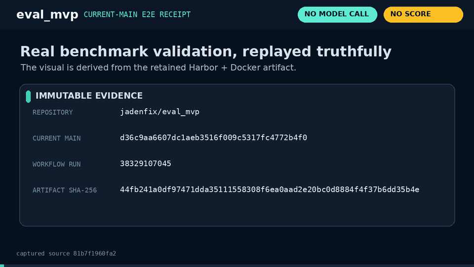

# eval_mvp

Small local coding benchmark: Python's standard library + Harbor + Docker.



The walkthrough above is a source/output visualization of the actual retained
current-main E2E evidence from [workflow run 38329107045](https://github.com/jadenfix/eval_mvp/actions/runs/38329107045),
not a simulated model result. It shows 27 real Harbor/Docker validation trials:
22 reference/negative-control trials and five trials proving that a deliberately
broken reference fails closed. No model was called and no benchmark score was
measured. See [the MP4](demo/eval_mvp.mp4),
[receipt](demo/e2e_receipt.json), and [capture manifest](demo/capture.json).

## Run

Requires Python 3.9+, Docker running, and `harbor==0.23.0` on PATH:

```sh
uv tool install harbor==0.23.0
python3 benchmark.py --check
python3 benchmark.py --model provider/model
```

Replace `provider/model` with your actual model identifier and set its provider
credentials in your environment. Terminus-2 is the fixed agent harness. Task
containers have no network; model requests run on the host. No model is called
by `--check`.

## Tasks

Five scored tasks: CSV aggregation, configuration precedence, SQLite transactions,
dependency ordering, and a CLI feature. The original sum example and a permissions
probe are smoke checks, excluded from scoring. Each task contains instructions,
starting files, a reference solution, and a deliberately incomplete solution.
The runner assembles these into Harbor's task format using a shared grader.

`--check` requires two passing reference runs, a failing unchanged run, and a
failing incomplete solution per scored task, plus passing smoke checks. A scored
run requires a matching validation receipt for the source hash and exact images.
Changing source or rebuilding different images requires another check.

## Protocol

`benchmark.json` fixes the benchmark version, task list, Harbor version, agent,
limits, and settings. Default evaluation: three attempts per task, sequential,
no retries. Score = successful attempts / 15. Agent timeouts count as unsuccessful;
infrastructure failures, missing results, or inconsistent grading make the run
incomplete with no score. `--deadline 3600` bounds the whole run; labeled task
containers are cleaned up after interruption or failure.

The agent and verifier are separate containers. Only /app is submitted. Grading
code stays protected, and submitted programs execute as an unprivileged user with
CPU, memory, output-size, and execution limits. Tests include reproducible generated
inputs and regression cases. Reference solutions never enter the agent image.

Images are built from a digest-pinned Python image. The runner records the exact
built image IDs, source hash, settings, individual outcomes, agent versions,
trajectories, and test logs in `runs/<id>/`. `runs/` and credentials are gitignored.
Source changes during execution invalidate the measurement. Freeze task content
for a release; changes require a new benchmark version and fresh measurements.

## Verify the runner

```sh
python3 -m unittest discover -s tests -v
```

Run the end-to-end tests with Harbor and Docker (takes several minutes):

```sh
EVAL_MVP_E2E=1 python3 -m unittest discover -s tests -p test_e2e.py -v
```

These invoke the real CLI in isolated benchmark copies: complete validation,
protected grading, report and receipt checks, rejection of a broken reference,
and container cleanup. They make no model calls. Evidence stays in `runs/e2e/`.

GitHub Actions separates the fast runner checks from a Docker E2E job. The
Docker job installs the pinned Harbor version, explicitly enables both E2E
tests, and retains CLI/grader evidence even on failure. A passing unit job
alone is not evidence that the container workflow passed.

Verify the checked-in receipt and demo media with:

```sh
python3 scripts/verify_demo.py
```

The verifier pins the captured source commit/tree and every source blob, checks
the receipt and artifact hashes, fully decodes the GIF/MP4/poster, validates
dimensions/frame counts/durations, and requires a clean checkout.

Verified locally: nine runner tests and both end-to-end tests passed. The E2E run
executed 27 real container trials, including all 22 successful-validation trials
and five trials rejecting a broken reference. No model-backed benchmark score
has been measured yet.

This small suite measures functional correctness, not code quality or general
coding ability. Public test code and fixed seeds are not a private holdout.
Validation does not establish resistance to container escapes. Use versioned
model identifiers when available; remote provider behavior is outside our control.

